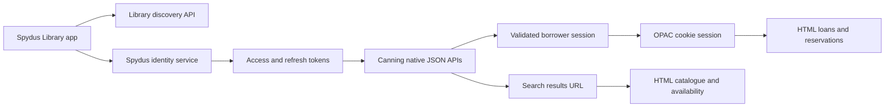

# Spydus API reconstruction

Inspected **Spydus Library 2.0.6** on Orca's **Pixel_10_Pro**, using `npx rea-agents@latest` (6.3.0 during extraction; 6.4.0 for final checks), Orca CLI, managed assembly inspection, and local HTTP captures. The signed-in library is **City of Canning**.

The app uses two transports: native JSON APIs and an embedded Spydus OPAC website. Native catalogue search returns a URL to an HTML results page; loans and reservations are HTML pages too. LibreSpydus, the rebuild below, reads the OPAC website directly.

| Artifact | Contents |
| --- | --- |
| [Native endpoint reference](docs/api/native-endpoints.md) | 23 compiled operations; methods, routes, headers, parameters, body fields, 29 DTO types. Eight operations observed in original app traffic. |
| [Native contract JSON](docs/api/native-endpoints.json) | Machine-readable contracts, static metadata tokens, hashes, and live observation details. |
| [Web endpoint reference](docs/api/web-endpoints.md) | 36 web route/action contracts: catalogue, availability, authenticated loans/reservations, and referenced actions. Each finding labels its evidence. |
| [Web contract JSON](docs/api/web-endpoints.json) | Source locations, query/form fields, selectors, and coverage limits. |
| [Authentication and session bridge](docs/api/authentication.md) | OAuth settings, token naming differences, borrower identifiers, and WebView cookies. |
| [Postman collection](docs/api/spydus.postman_collection.json) | 23 native operations plus the authorization entry point. Credentials and account identifiers are empty variables. |
| [Deidentified app traffic](docs/api/fixtures/native-traffic.har) | Eleven captured native requests/responses; credentials removed, account values replaced, notification text redacted. |
| [Account HTML field map](docs/api/account-shape.json) | Selectors and extraction shapes for dashboard, loans, and reservations, with account/reading values omitted. |
| [Investigation record](docs/api/investigation.md) | Tools, artifact identity, REA evidence, capture method, cleanup, verification, and remaining work. |

Service bases:

- Library discovery: `https://librarylist.spydus.com/api/1.0`
- Identity: `https://idp.spydus.com`
- Selected library: `https://canning.spydus.com`

Import the Postman collection to inspect request templates. Its JSON API calls and web action references include operations that alter the real library account; the investigation only exercised reads and existing-session validation. The collection has no automatic execution scripts.

## LibreSpydus

LibreSpydus is the rebuild: native SwiftUI (`ios/`) and Jetpack Compose (`android/`) apps on a shared Rust core (`core/`, through UniFFI) that talks to the library's OPAC directly from the phone, with no server in between. The build contract is [docs/native-apps.md](docs/native-apps.md), and the core's API is in [core/README.md](core/README.md).

There is also a desktop app (`desktop/`, GPUI) and `spydus`, a command-line client (`cli/`, contract [docs/cli.md](docs/cli.md), usage [cli/README.md](cli/README.md)), both on the same core.

This is a reconstruction of the installed client's observable and compiled contracts. It does not claim an exhaustive inventory of Spydus's server APIs. Authentication exchange/refresh, mutations, tenant-disabled features, and error/expiry cases still have explicitly documented gaps.

Raw APKs, assemblies, screenshots, authenticated HTML, HARs, and capture tools are kept under ignored `.private/`. Reusable docs and collection files do not contain captured credentials. Nothing was published.
